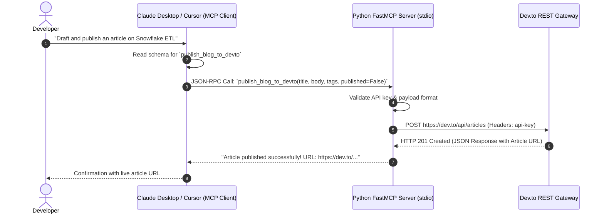

# 🚀 Dev.to Model Context Protocol (MCP) Server

[](https://python.org)
[-8A2BE2?style=flat)](https://modelcontextprotocol.io)
[](https://github.com/jlowin/fastmcp)
[](https://developers.forem.com/api)
[](https://github.com/astral-sh/uv)
[](LICENSE)

A production-ready **Model Context Protocol (MCP)** server built in Python using **FastMCP**. It exposes Dev.to publishing capabilities as native, schema-validated tools directly invocable by agentic LLMs and IDE assistants such as **Claude Desktop**, **Cursor**, and other MCP-compliant agents.

---

## 📐 Architecture & Interaction Flow

The server establishes a secure `stdio` (standard input/output) channel using JSON-RPC 2.0. Rather than making manual API calls, your AI agent autonomously binds parameters to the tool schema and executes the publish command natively.



---

## ✨ Features & Capabilities

* **Native Tool Integration**: Exposes `publish_blog_to_devto` with strict parameter validation.
* **Drafts or Live Publishing**: Seamlessly switch between publishing immediate live articles or drafting articles (`published: bool = False`) for manual review on Dev.to.
* **Metadata & Canonical URLs**: Built-in support for article tags, series identifiers, custom cover images, and canonical URL cross-posting.
* **High-Performance Transport**: Uses standard I/O (`stdio`) to avoid port collisions and firewall restrictions on local development machines.
* **Blazing Fast Virtual Environment**: Managed with Astral's `uv` package manager for sub-second environment initialization and dependency resolution.

---

## 🛠️ Tool Schema Reference

### `publish_blog_to_devto`

| Parameter | Type | Required | Description |
| :--- | :--- | :---: | :--- |
| `title` | `string` | **Yes** | The headline or title of the blog post. |
| `body_markdown` | `string` | **Yes** | Full article content written in Markdown format. |
| `tags` | `string[]` | No | List of up to 4 tags (e.g. `["python", "ai", "datascience"]`). |
| `published` | `boolean` | No | `false` to save as a draft (default), `true` to publish immediately. |
| `series` | `string` | No | Name of the series to group the post into. |
| `canonical_url` | `string` | No | Original article URL if cross-posting from an external blog. |
| `cover_image` | `string` | No | Direct image URL to display as the article's hero banner. |

---

## 🚀 Quickstart Guide

### 1. Prerequisites

* **Python 3.10+**
* **Astral `uv`** (Python package installer):
  ```bash
  curl -LsSf https://astral.sh/uv/install.sh | sh
  ```
* **Dev.to API Key**: Generate your key at [dev.to/settings/extensions](https://dev.to/settings/extensions) under **DEV Community API Keys**.

---

### 2. Installation & Setup

1. **Clone the repository:**
   ```bash
   git clone https://github.com/Kiruthick7/mcp.git
   cd mcp
   ```

2. **Create and activate a virtual environment with `uv`:**
   ```bash
   uv venv
   source .venv/bin/activate
   ```

3. **Install dependencies:**
   ```bash
   uv sync
   ```

4. **Configure environment variables:**
   ```bash
   cp .env.template .env
   ```
   Add your Dev.to API key in `.env`:
   ```bash
   DEVTO_API_KEY=your_devto_api_key_here
   ```

---

## 🔌 Connecting to MCP Clients

### A. Claude Desktop Integration

Edit your Claude Desktop configuration file:
* **macOS**: `~/Library/Application Support/Claude/claude_desktop_config.json`
* **Windows**: `%APPDATA%\Claude\claude_desktop_config.json`

Add the `devto-publisher` server block:

```json
{
  "mcpServers": {
    "devto-publisher": {
      "command": "uv",
      "args": [
        "--directory",
        "/ABSOLUTE/PATH/TO/mcp",
        "run",
        "dev-server.py"
      ],
      "env": {
        "DEVTO_API_KEY": "your_devto_api_key_here"
      }
    }
  }
}
```

> **Note**: Replace `/ABSOLUTE/PATH/TO/mcp` with your actual repository path (run `pwd` inside the repository).

Restart Claude Desktop, and you will see the hammer 🔨 tool icon showing `publish_blog_to_devto` ready to use!

---

### B. Testing with the MCP Inspector

You can interactively test and debug your MCP server using the official Anthropic MCP Inspector:

```bash
npx @modelcontextprotocol/inspector uv --directory $(pwd) run dev-server.py
```

This launches a local web UI at `http://localhost:5173` where you can inspect schemas, send test payloads, and verify Dev.to API responses.

---

## 🔒 Security & Best Practices

1. **Token Isolation**: Never hardcode API keys. Keys are passed via local `.env` or client environment parameters.
2. **Local Stdio Sandboxing**: Because execution uses `stdio`, no external HTTP ports are exposed on your host machine.
3. **Safe Draft Defaults**: By default, `published: false` prevents accidental live publication until content is reviewed in Dev.to drafts.

---

## 📄 License

This project is licensed under the [MIT License](LICENSE).
